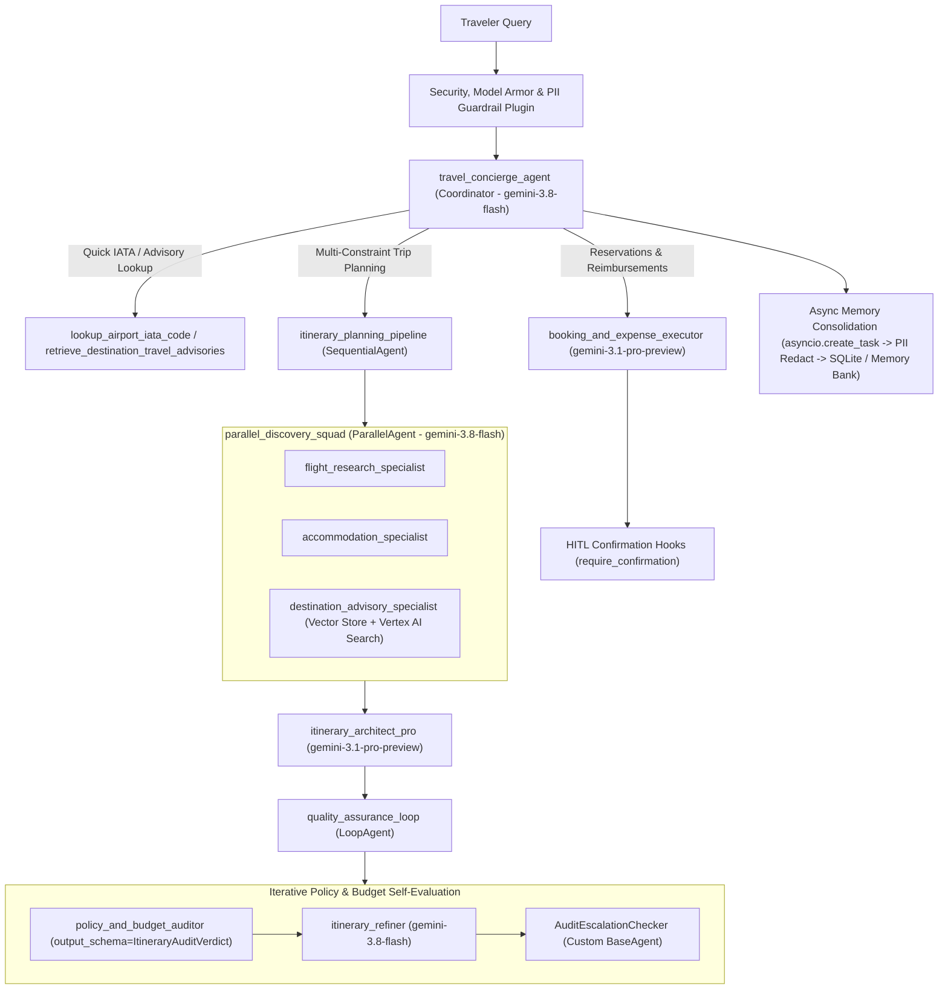

# Smart Travel & Expense Concierge (`travel-concierge-agent`)

An enterprise-grade **Smart Travel & Expense Concierge** built with the **Google Agent Development Kit (`google-adk`)** and **`google-agents-cli` (`agents-cli`)**, engineered for deployment on **Google Cloud Run** with **Terraform Infrastructure as Code (IaC)** and **GitHub Actions CI/CD**.

## Problem & Solution

Planning multi-day business or personal trips typically forces travelers to juggle fragmented flight engines, hotel rate caps, destination visa/safety advisories, tax/per-diem math, and post-trip expense filings—creating policy overages and accidental exposure of sensitive personal data (payment cards, passport numbers, emails).

**Smart Travel & Expense Concierge** automates the entire travel lifecycle through a coordinated multi-agent architecture while enforcing **Human-in-the-Loop (HITL)** approval gates on every financial commitment, active **PII redaction** across logs and cross-session memory, **OpenTelemetry** distributed tracing, and **strategic Gemini Flash / Pro model routing**.

---

## System Architecture



---

## AgentOps Engineering & Rubric Matrix

| Pillar | Capability | Implementation & Code Evidence |
| :--- | :--- | :--- |
| **1. Tool & Interface Design** | **Comprehensive Docstrings** | Every tool in `app/tools/discovery_tools.py` and `app/tools/transaction_tools.py` includes full Google-style docstrings detailing purpose, `Args:`, `Returns:`, and recovery behavior. |
| | **Descriptive Naming** | Action-specific `verb_noun` names: `lookup_airport_iata_code`, `search_verified_flight_options`, `search_curated_hotel_inventory`, `retrieve_destination_travel_advisories`, `calculate_trip_budget_breakdown`, `reserve_itinerary_booking`, `submit_expense_reimbursement_claim`. |
| | **Explicit JSON Schemas** | Strict Pydantic v2 models (`ConfigDict(extra="forbid")`, regex patterns, numeric bounds) in `app/schemas.py`, `TOOL_JSON_SCHEMAS` registry, and structured `output_schema=ItineraryAuditVerdict`. |
| | **Guided Error Handling** | All tools return structured `GuidedToolErrorResponse` payloads (`error_code`, `recoverable`, `recovery_instructions`, `suggested_next_tool`) paired with `ReflectAndRetryToolPlugin`. |
| **2. Context & Memory** | **Robust System Instructions** | Explicit constitutional prompts in `app/prompts.py` defining Persona, Domain Rules, Routing Protocol, HITL/PII Safety Mandates, and `{traveler_profile_summary?}` dynamic state injection. |
| | **History Compaction** | `App` (`app/agent.py`) configures `EventsCompactionConfig` (both sliding-window `compaction_interval=12, overlap_size=3` and `token_threshold=24000` with `LlmEventSummarizer`), `ContextCacheConfig`, and `ContextFilterPlugin`. |
| | **Persistent Session State** | `app/app_utils/services.py` supports Cloud SQL PostgreSQL, `VertexAiSessionService`, and persistent `SqliteSessionService`; `app/memory/knowledge_store.py` provides SQLite + TF-IDF cosine vector retrieval and optional `VertexAiSearchTool`. |
| | **Async Memory Operations** | `app/memory/async_memory.py` dispatches `asyncio.create_task` in `after_agent_callback` to extract preferences, scrub PII, and persist to SQLite + ADK Memory Bank without blocking turn streaming, paired with `PreloadMemoryTool`. |
| **3. Orchestration & Logic** | **Multi-Agent Patterns** | Coordinator `LlmAgent` (`app/agent.py`) orchestrating `SequentialAgent`, `ParallelAgent` (3 concurrent specialists), and `LoopAgent` with custom `BaseAgent` `AuditEscalationChecker` (`app/sub_agents/workflows.py`). |
| | **Strategic Model Routing** | `StrategicModelRouter` (`app/routing.py`) assigns `gemini-3.8-flash` to low-latency routing, parallel lookups, and compaction, and `gemini-3.1-pro-preview` to multi-constraint itinerary synthesis, auditing, and booking execution. |
| | **Guardrails & Policy Plugins** | `TravelPolicyGuardrailPlugin` (`app/plugins/guardrails.py`) screens prompt injection/fraud, integrates optional Google Cloud Model Armor (`google-cloud-modelarmor`), enforces booking/claim dollar caps, and scrubs output PII. |
| | **Human-in-the-Loop Hooks** | `reserve_itinerary_booking_tool` (`require_confirmation=requires_booking_confirmation`) and `submit_expense_reimbursement_claim_tool` (`require_confirmation=True`) combined with `ResumabilityConfig(is_resumable=True)`. |
| **4. Observability & Tracing** | **Structured JSON Logging** | `StructuredJsonFormatter` (`app/observability/structured_logging.py`) emits Cloud Logging JSON payloads with trace correlation and zero `print()` calls in `app/` (enforced via AST unit test). |
| | **Intent vs. Outcome Capture** | `IntentOutcomeAuditPlugin` (`app/plugins/intent_outcome_logger.py`) logs paired `AGENT_INTENT`/`TOOL_INTENT` (before execution) and `AGENT_OUTCOME`/`TOOL_OUTCOME` (after execution with `duration_ms` and `correlation_id`). |
| | **Distributed Tracing** | `app/observability/tracing.py` configures OpenTelemetry `TracerProvider`, `CloudTraceSpanExporter`, linked `@traced_span` spans, and `otel_to_cloud=True` in `app/fast_api_app.py`. |
| | **PII Redaction** | `PiiRedactionService` (`app/security/pii_redactor.py`) combines regex redaction with optional Google Cloud Sensitive Data Protection (`google-cloud-dlp`) across both structured logging filters and async memory writes. |
| **5. Infrastructure & CI/CD** | **Automated Evaluation Suites** | Golden evaluation dataset (`tests/eval/datasets/basic-dataset.json`), `eval_config.yaml`, LLM-as-judge (`response_quality.py`), deterministic golden regression harness (`tests/eval/golden_regression_harness.py`), and 19 unit tests (`tests/unit/`). |
| | **Infrastructure as Code** | Complete Terraform configurations under `deployment/terraform/single-project/` and `deployment/terraform/cicd/` (Cloud Run, Cloud SQL, Secret Manager, Cloud Trace/Logging/BQ sinks, DLP/Model Armor APIs, GitHub Actions WIF). |
| | **Secure Secret Management** | `SecretManagerService` (`app/security/secrets.py`) backed by `google-cloud-secret-manager`, Terraform `ephemeral` passwords + `secret_key_ref`, `.env.example` placeholders, and automated credential-hygiene tests. |

---

## Project Layout

```text
travel-concierge-agent/
├── DESIGN_SPEC.md                 # Architectural design specification
├── AGENTS.md                      # Coding-agent development guidance
├── Dockerfile                     # Production Cloud Run container image
├── Makefile                       # Developer & CI shortcut commands
├── agents-cli-manifest.yaml       # google-agents-cli project manifest
├── pyproject.toml                 # Dependencies & Ruff / pytest / ty settings
├── app/
│   ├── agent.py                   # Root Coordinator + App(compaction, cache, plugins)
│   ├── fast_api_app.py            # Cloud Run FastAPI + Runner + A2A + Cloud Trace
│   ├── prompts.py                 # Constitutional system instructions
│   ├── routing.py                 # Strategic Flash vs. Pro model router
│   ├── schemas.py                 # Strict Pydantic v2 input/output JSON schemas
│   ├── memory/                    # Persistent SQLite/Vector store & async memory bank
│   ├── observability/             # Structured JSON logging & OpenTelemetry tracing
│   ├── plugins/                   # Security guardrails & Intent-vs-Outcome audit plugin
│   ├── security/                  # Secret Manager client & Cloud DLP/regex PII redactor
│   ├── sub_agents/                # ParallelAgent, SequentialAgent, LoopAgent + Escalator
│   ├── tools/                     # Validated discovery & HITL booking/expense tools
│   └── app_utils/                 # Shared persistent session, memory, & A2A services
├── deployment/terraform/          # Single-project & CI/CD Terraform modules
├── .github/workflows/             # PR quality gates, staging, and prod workflows
└── tests/
    ├── eval/                      # Golden datasets, eval_config.yaml, & regression harness
    ├── unit/                      # Deterministic unit tests across all 19 rubric criteria
    └── integration/               # Live streaming & A2A server end-to-end tests
```

---

## Quick Start & `agents-cli` Workflow

### 1. Prerequisites
- **Python 3.11–3.13** and **[uv](https://docs.astral.sh/uv/getting-started/installation/)**
- **Google Agents CLI (`agents-cli`)**:
  ```bash
  uv tool install google-agents-cli
  agents-cli info
  ```
- **Google Cloud SDK (`gcloud`)** & **Terraform >= 1.9** (for cloud deployment)

### 2. Local Setup & Verification

```bash
# Copy environment template and configure your GCP project or Gemini API key
cp .env.example .env

# Install locked dependencies via agents-cli or uv
agents-cli install

# Run static lint, spellcheck, and type checks
agents-cli lint

# Run the deterministic unit test suite and golden regression harness (no cloud spend)
uv run pytest tests/unit -v
```

### 3. Interactive Testing & Local Execution with `agents-cli`

```bash
# Run a one-off smoke prompt locally
agents-cli run "Which verified IATA airport codes serve Tokyo, Japan?"

# Launch the interactive ADK web playground with trace inspection
agents-cli playground
```

### 4. Automated Evaluation (`agents-cli eval`)

```bash
# Execute golden dataset generation + LLM-as-judge & PII safety grading
agents-cli eval run --config tests/eval/eval_config.yaml

# Compare candidate evaluation results against a baseline for regressions
agents-cli eval compare artifacts/grade_results/baseline.json artifacts/grade_results/candidate.json
```

---

## Infrastructure as Code (Terraform) & Cloud Deployment

### Single-Project Provisioning & Deployment
Provision Cloud Run, Cloud SQL (`POSTGRES_15`), Secret Manager secrets, BigQuery/GCS telemetry sinks, and least-privilege IAM service accounts programmatically:

```bash
export CLOUDSDK_CORE_PROJECT="your-gcp-project-id"
gcloud config set project "$CLOUDSDK_CORE_PROJECT"

# Provision single-project Terraform infrastructure
agents-cli infra single-project

# Store external partner credentials securely in Secret Manager (never in code)
printf "partner-token-value" | gcloud secrets versions add travel-concierge-agent-partner-api-key --data-file=-

# Build and deploy the Cloud Run service
agents-cli deploy
```

You can also inspect or plan the Terraform modules directly:

```bash
cd deployment/terraform/single-project
terraform init
terraform plan -var="project_id=your-gcp-project-id"
```

### Production Multi-Environment CI/CD Setup
To provision staging + production infrastructure and configure keyless **Workload Identity Federation (WIF)** for GitHub Actions (`.github/workflows/pr_checks.yaml`, `staging.yaml`, `deploy-to-prod.yaml`):

```bash
agents-cli infra cicd
```

---

## License

Apache License 2.0 — see file headers for details.
